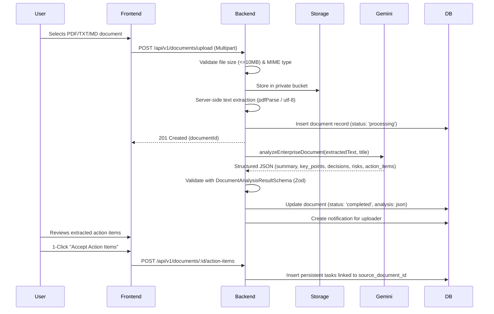
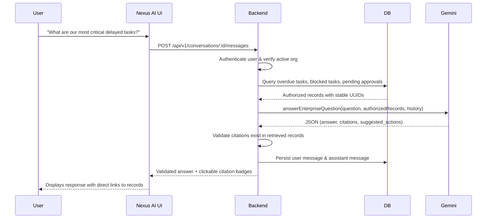

# NexusFlow AI — System Architecture Specification

## 1. System Overview
**NexusFlow AI** is a production-grade, centralized operational intelligence platform designed to eliminate organizational fragmentation. It integrates enterprise tasks, documents, multi-stage approval workflows, and evidence-grounded AI intelligence under a unified, role-based architecture.

```mermaid
graph TD
    Client["React 18 + Vite SPA (Tailwind CSS, TanStack Query)"]
    API["Express.js REST API (Node.js LTS, TypeScript)"]
    DB[(Supabase PostgreSQL 15 + Row Level Security)]
    Storage["Supabase Storage (Private 'enterprise-documents' Bucket)"]
    Gemini["Google Gemini API (Official @google/genai SDK)"]

    Client -->|HTTP / REST + JWT| API
    API -->|User-Scoped Client + RLS| DB
    API -->|Service-Role Client (Privileged Auth & Webhooks)| DB
    API -->|Multipart Upload + S3 Stream| Storage
    API -->|Structured Prompts + Schema Validation| Gemini
```

---

## 2. Core Architectural Pillars

### 2.1 Multi-Tenant Data Isolation
- Organizations are isolated via a mandatory foreign key `organization_id` on all 19 enterprise tables.
- All database operations on the client and server use either:
  1. The user's authenticated JWT, triggering PostgreSQL Row Level Security (RLS) policies.
  2. The server-side service role client, which explicitly enforces organization verification and cross-tenant checks in backend middleware (`requireOrgMember`).

### 2.2 Grounded Enterprise Context (Anti-Hallucination)
Before querying Gemini for operational queries:
1. The backend verifies the user's active membership and department permissions.
2. An authorized search retrieves relevant active tasks, documents, workflows, and approvals from PostgreSQL.
3. A bounded context containing verified record IDs is supplied to Gemini.
4. Gemini's structured response is parsed with Zod schemas.
5. Every citation returned by the model is validated against the set of retrieved record IDs. Any non-existent or unverified ID is filtered out prior to client delivery.

### 2.3 Deterministic Workflow Engine
- Workflows are defined as ordered JSON step graphs.
- Execution occurs strictly on the server:
  - Step actions: `create_task`, `assign_task`, `request_approval`, `update_task_status`, `add_activity`, `generate_summary`.
  - Execution idempotency is guaranteed via unique `(organization_id, idempotency_key)` constraints.
  - Cycle detection and recursion depth safeguards prevent infinite loops (max 20 steps, max depth 5).

### 2.4 Immutable Governance & Audit Trails
- Formal approvals require reviewer justification comments and record actor decisions in an append-only `approval_history` table.
- Self-approval prohibition policies prevent requesters from authorizing their own requests unless explicitly overridden by organization policy.
- System-wide security actions (organization creation, membership alteration, workflow execution, document indexing) are committed to `audit_logs`.

---

## 3. Data Flow Diagrams

### 3.1 Document Intelligence Pipeline


### 3.2 Conversational Assistant (Nexus AI) Flow

